# Sintaxe básica de escrita e formatação

Crie uma formatação sofisticada para sua prosa e código em GitHub com sintaxe simples.

## Títulos

Para criar um título, adicione um a seis <kbd>#</kbd> símbolos antes do texto do título. O número de <kbd>#</kbd> uso determinará o nível da hierarquia e o tamanho da face de tipo do título.

```markdown
# A first-level heading
## A second-level heading
### A third-level heading
```

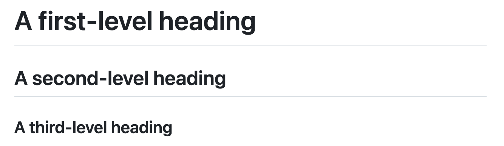

Quando você usa dois ou mais títulos, GitHub gera automaticamente um sumário que você pode acessar clicando no ícone <svg version="1.1" width="16" height="16" viewBox="0 0 16 16" class="octicon octicon-list-unordered" aria-label="Table of Contents" role="img"><path d="M5.75 2.5h8.5a.75.75 0 0 1 0 1.5h-8.5a.75.75 0 0 1 0-1.5Zm0 5h8.5a.75.75 0 0 1 0 1.5h-8.5a.75.75 0 0 1 0-1.5Zm0 5h8.5a.75.75 0 0 1 0 1.5h-8.5a.75.75 0 0 1 0-1.5ZM2 14a1 1 0 1 1 0-2 1 1 0 0 1 0 2Zm1-6a1 1 0 1 1-2 0 1 1 0 0 1 2 0ZM2 4a1 1 0 1 1 0-2 1 1 0 0 1 0 2Z"></path></svg> de menu "Estrutura de Tópicos" dentro do cabeçalho do arquivo. Cada título de título está listado no sumário e você pode clicar em um título para navegar até a seção selecionada.

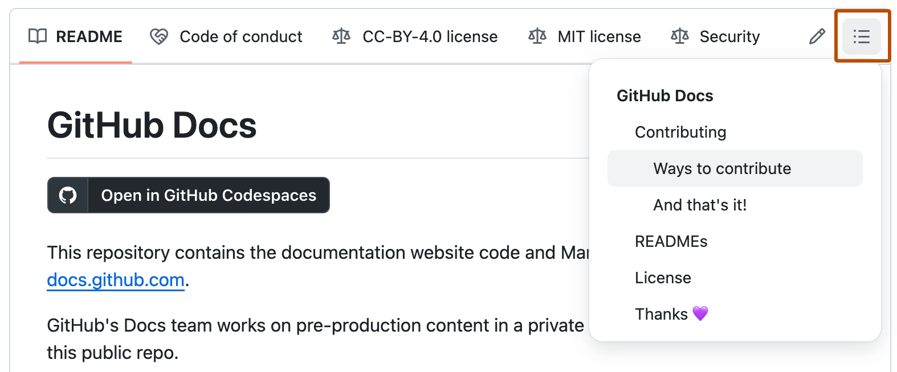

## Formatação de texto

Você pode indicar ênfase com texto em negrito, itálico, tachado, subscrito ou sobrescrito em campos de comentário e `.md` arquivos.

| Estilo                                                                                | Sintaxe                                           | Atalho de teclado                        | Example                                 | Saída                                  |
| ------------------------------------------------------------------------------------- | ------------------------------------------------- | ---------------------------------------- | --------------------------------------- | -------------------------------------- |
| Negrito                                                                               |                                                   |                                          |                                         |                                        |
| `** **` ou `__ __`                                                                    |                                                   |                                          |                                         |                                        |
| <kbd>Command</kbd>+<kbd>B</kbd> (Mac) ou <kbd>Ctrl</kbd>+<kbd>B</kbd> (Windows/Linux) | `**This is bold text**`                           |                                          |                                         |                                        |
| **Este é um texto em negrito**                                                        |                                                   |                                          |                                         |                                        |
| Itálico                                                                               |                                                   |                                          |                                         |                                        |
| `* *` ou `_ _`                                                                        |                                                   |                                          |                                         |                                        |
| <kbd>Command</kbd>+<kbd>I</kbd> (Mac) ou <kbd>Ctrl</kbd>+<kbd>I</kbd> (Windows/Linux) | `_This text is italicized_`                       |                                          |                                         |                                        |
| *Este texto é itálico*                                                                |                                                   |                                          |                                         |                                        |
| Tachado                                                                               |                                                   |                                          |                                         |                                        |
| `~~ ~~` ou `~ ~`                                                                      | None                                              | `~~This was mistaken text~~`             |                                         |                                        |
| ~~Este foi um texto errado~~                                                          |                                                   |                                          |                                         |                                        |
| Negrito e itálico aninhado                                                            |                                                   |                                          |                                         |                                        |
| `** **` e `_ _`                                                                       | None                                              | `**This text is _extremely_ important**` |                                         |                                        |
| **Este texto é *extremamente* importante**                                            |                                                   |                                          |                                         |                                        |
| Tudo em negrito e itálico                                                             | `*** ***`                                         | None                                     | `***All this text is important***`      |                                        |
| ***Todo esse texto é importante***                                                    | <!-- markdownlint-disable-line emphasis-style --> |                                          |                                         |                                        |
| Subscrito                                                                             | `<sub> </sub>`                                    | None                                     | `This is a <sub>subscript</sub> text`   | Este é um texto <sub>subscrito</sub>   |
| Sobrescrito                                                                           | `<sup> </sup>`                                    | None                                     | `This is a <sup>superscript</sup> text` | Este é um texto <sup>sobrescrito</sup> |
| Sublinhado                                                                            | `<ins> </ins>`                                    | None                                     | `This is an <ins>underlined</ins> text` | Este é um texto <ins>sublinhado</ins>  |

## Citando texto

Você pode citar texto com um <kbd>></kbd>.

```markdown
Text that is not a quote

> Text that is a quote
```

O texto entre aspas é recuado com uma linha vertical à esquerda e exibido usando o tipo cinza.

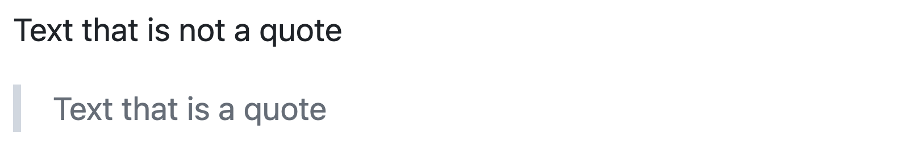

> [!NOTE]
> Ao exibir uma conversa, você pode citar automaticamente o texto em um comentário realçando o texto e digitando <kbd>R</kbd>. Você pode citar um comentário inteiro clicando e, em seguida, citando <svg version="1.1" width="16" height="16" viewBox="0 0 16 16" class="octicon octicon-kebab-horizontal" aria-label="The horizontal kebab icon" role="img"><path d="M8 9a1.5 1.5 0 1 0 0-3 1.5 1.5 0 0 0 0 3ZM1.5 9a1.5 1.5 0 1 0 0-3 1.5 1.5 0 0 0 0 3Zm13 0a1.5 1.5 0 1 0 0-3 1.5 1.5 0 0 0 0 3Z"></path></svg>**a resposta**. Para obter mais informações sobre atalhos de teclado, consulte [Atalhos do teclado](/pt/get-started/accessibility/keyboard-shortcuts).

## Citar código

Você pode destacar um código ou comando dentro de uma sentença com um único backtick. O texto dentro dos `backticks` não será formatado. Você também pode pressionar o <kbd>Command</kbd>+<kbd>E</kbd> (Mac) ou <kbd>Ctrl> Atalho de teclado </kbd>+<kbd>E</kbd> (Windows/Linux) para inserir os backticks de um bloco de código dentro de uma linha de Markdown.

```markdown
Use `git status` to list all new or modified files that haven't yet been committed.
```

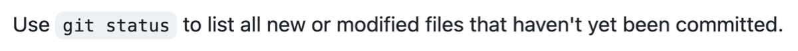

Para formatar código ou texto em seu próprio bloco distinto, use backticks triplos.

````markdown
Some basic Git commands are:
```
git status
git add
git commit
```
````

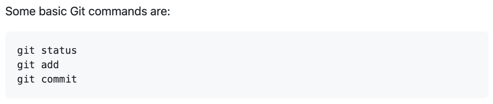

Para saber mais, confira [Criar e realçar blocos de código](/pt/get-started/writing-on-github/working-with-advanced-formatting/creating-and-highlighting-code-blocks).

Se você editar tabelas e snippets de código com frequência, poderá se beneficiar da habilitação de uma fonte de largura fixa em todos os campos de comentário no GitHub. Para saber mais, confira [Sobre como escrever e formatar em GitHub](/pt/get-started/writing-on-github/getting-started-with-writing-and-formatting-on-github/about-writing-and-formatting-on-github#enabling-fixed-width-fonts-in-the-editor).

## Modelos de cores com suporte

Em issues, pull requests e discussões, você pode destacar cores dentro de uma frase usando backticks. Um modelo de cores com suporte em backticks exibirá uma visualização da cor.

```markdown
The background color is `#ffffff` for light mode and `#000000` for dark mode.
```

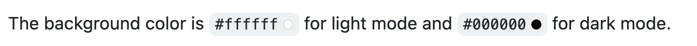

Aqui estão os modelos de cores com suporte no momento.

| Cor | Sintaxe                     | Example                             | Saída                                                                                                                                                                                           |
| --- | --------------------------- | ----------------------------------- | ----------------------------------------------------------------------------------------------------------------------------------------------------------------------------------------------- |
| HEX | <code>\`#RRGGBB\`</code>    | <code>\`#0969DA\`</code>            |           |
| RGB | <code>\`rgb(R,G,B)\`</code> | <code>\`rgb(9, 105, 218)\`</code>   |       |
| HSL | <code>\`hsl(H,S,L)\`</code> | <code>\`hsl(212, 92%, 45%)\`</code> |  |

> [!NOTE]
>
> * Um modelo de cores com suporte não pode ter espaços à esquerda ou à direita dentro dos backticks.
> * A visualização da cor só tem suporte em problemas, solicitações de pull e discussões.

## Links

Você pode criar um link embutido encapsulando o texto do link entre colchetes `[ ]`e encapsulando a URL entre parênteses `( )`. Você também pode usar o atalho de teclado <kbd>Command</kbd>+<kbd>K</kbd> para criar um link. Quando você tiver o texto selecionado, poderá colar uma URL da área de transferência para criar automaticamente um link do texto selecionado.

Você também pode criar um hiperlink markdown realçando o texto e usando o atalho de teclado <kbd>Comando</kbd>+<kbd>V</kbd>. Se você quiser substituir o texto pelo link, use o atalho <kbd>de teclado Command</kbd>+<kbd>Shift</kbd>+<kbd>V</kbd>.

`This site was built using [GitHub Pages](https://pages.github.com/).`

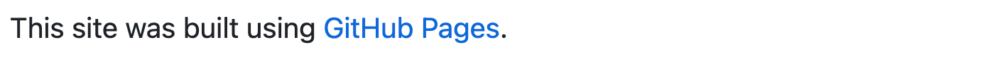

> [!NOTE]
> GitHub cria automaticamente links quando URLs válidas são escritas em um comentário. Para saber mais, confira [Referências e URLs com links automáticos](/pt/get-started/writing-on-github/working-with-advanced-formatting/autolinked-references-and-urls).

## Ligações de secção

Você pode criar um link direto para qualquer seção que tenha um título. Para visualizar a âncora gerada automaticamente em um arquivo renderizado, passe o mouse sobre o cabeçalho da seção para expor o ícone <svg version="1.1" width="16" height="16" viewBox="0 0 16 16" class="octicon octicon-link" aria-label="the link" role="img"><path d="m7.775 3.275 1.25-1.25a3.5 3.5 0 1 1 4.95 4.95l-2.5 2.5a3.5 3.5 0 0 1-4.95 0 .751.751 0 0 1 .018-1.042.751.751 0 0 1 1.042-.018 1.998 1.998 0 0 0 2.83 0l2.5-2.5a2.002 2.002 0 0 0-2.83-2.83l-1.25 1.25a.751.751 0 0 1-1.042-.018.751.751 0 0 1-.018-1.042Zm-4.69 9.64a1.998 1.998 0 0 0 2.83 0l1.25-1.25a.751.751 0 0 1 1.042.018.751.751 0 0 1 .018 1.042l-1.25 1.25a3.5 3.5 0 1 1-4.95-4.95l2.5-2.5a3.5 3.5 0 0 1 4.95 0 .751.751 0 0 1-.018 1.042.751.751 0 0 1-1.042.018 1.998 1.998 0 0 0-2.83 0l-2.5 2.5a1.998 1.998 0 0 0 0 2.83Z"></path></svg> e clique no ícone para exibir a âncora em seu navegador.

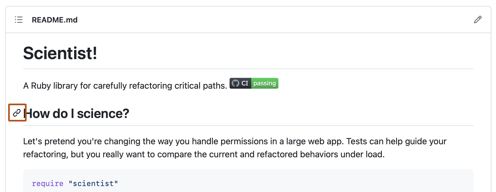

Se você precisar determinar a âncora de um título em um arquivo que está editando, poderá usar as seguintes regras básicas:

* As letras são convertidas em minúsculas.
* Os espaços são substituídos por hifens (`-`). Qualquer outro espaço em branco ou caracteres de pontuação são removidos.
* Espaços em branco no início e no fim são removidos.
* A formatação de marcação é removida, deixando apenas o conteúdo (por exemplo, `_italics_` torna-se `italics`).
* Se a âncora gerada automaticamente para um título for idêntica a uma âncora anterior no mesmo documento, um identificador exclusivo será gerado acrescentando um hífen e um inteiro de incremento automático.

Para obter informações mais detalhadas sobre os requisitos de fragmentos de URI, consulte [RFC 3986: Uniform Resource Identifier (URI): Sintaxe genérica, Seção 3.5](https://www.rfc-editor.org/rfc/rfc3986#section-3.5).

O bloco de código abaixo demonstra as regras básicas usadas para gerar âncoras de títulos em conteúdo renderizado.

```markdown
# Example headings

## Sample Section

## This'll be a _Helpful_ Section About the Greek Letter Θ!
A heading containing characters not allowed in fragments, UTF-8 characters, two consecutive spaces between the first and second words, and formatting.

## This heading is not unique in the file

TEXT 1

## This heading is not unique in the file

TEXT 2

# Links to the example headings above

Link to the sample section: [Link Text](#sample-section).

Link to the helpful section: [Link Text](#thisll-be-a-helpful-section-about-the-greek-letter-Θ).

Link to the first non-unique section: [Link Text](#this-heading-is-not-unique-in-the-file).

Link to the second non-unique section: [Link Text](#this-heading-is-not-unique-in-the-file-1).
```

> [!NOTE]
> Se você editar um título ou alterar a ordem dos títulos com âncoras "idênticas", também precisará atualizar todos os links para esses títulos, pois as âncoras serão alteradas.

## Links relativos

É possível definir links relativos e caminhos de imagens em seus arquivos representados para ajudar os leitores a acessar outros arquivos no repositório.

Um link relativo é um link que é relativo ao arquivo atual. Por exemplo, se você tiver um arquivo LEIAME na raiz do repositório e tiver outro arquivo em *docs/CONTRIBUTING.md*, o link relativo para *CONTRIBUTING.md* no LEIAME poderá ter esta aparência:

```text
[Contribution guidelines for this project](docs/CONTRIBUTING.md)
```

O GitHub transformará automaticamente o link relativo ou o caminho da imagem baseado em qualquer branch em que você estiver no momento para que o link ou o caminho sempre funcione. O caminho do link será relativo ao arquivo atual. Links que começam com `/` serão relativos à raiz do repositório. Você pode usar todos os operandos de link relativos, como `./` e `../`.

O texto do link deve estar em uma única linha. O exemplo abaixo não funcionará.

```markdown
[Contribution
guidelines for this project](docs/CONTRIBUTING.md)
```

Os links relativos são mais fáceis para usuários que clonam o seu repositório. Os links absolutos podem não funcionar em clones do seu repositório - recomendamos usar links relativos para referir-se a outros arquivos no seu repositório.

## Âncoras personalizadas

Você pode usar marcas de âncora HTML padrão (`<a name="unique-anchor-name"></a>`) para criar pontos de âncora de navegação para qualquer local no documento. Para evitar referências ambíguas, use um esquema de nomenclatura exclusivo para marcas de âncora, como adicionar um prefixo ao valor do `name` atributo.

> [!NOTE]
> Âncoras personalizadas não serão incluídas no Sumário ou na estrutura de tópicos do documento.

Você pode vincular a uma âncora personalizada usando o valor do `name` atributo que você deu à âncora. A sintaxe é exatamente a mesma que quando você vincula a uma âncora gerada automaticamente para um título.

Por exemplo:

```markdown
# Section Heading

Some body text of this section.

<a name="my-custom-anchor-point"></a>
Some text I want to provide a direct link to, but which doesn't have its own heading.

(… more content…)

[A link to that custom anchor](#my-custom-anchor-point)
```

> [!TIP]
> As âncoras personalizadas não são consideradas pelo comportamento automático de nomenclatura e numeração de links automáticos de cabeçalho.

## Quebras de linha

Se você estiver escrevendo em problemas, solicitações de pull ou discussões em um repositório, GitHub renderizará uma quebra de linha automaticamente:

```markdown
This example
Will span two lines
```

No entanto, se você estiver escrevendo em um arquivo .md, o exemplo acima será renderizado em uma linha sem uma quebra de linha. Para criar uma quebra de linha em um arquivo .md, você precisará incluir um dos seguintes:

* Inclua dois espaços no final da primeira linha.
  <pre>
  This example&nbsp;&nbsp;
  Will span two lines
  </pre>

* Inclua uma barra invertida no final da primeira linha.

  ```markdown
  This example\
  Will span two lines
  ```

* Inclua uma tag de quebra de linha única HTML no final da primeira linha.

  ```markdown
  This example<br/>
  Will span two lines
  ```

Se você deixar uma linha em branco entre duas linhas, tanto arquivos .md quanto Markdown em issues, solicitações de pull e discussões, as duas linhas serão renderizadas separadas pela linha em branco.

```markdown
This example

Will have a blank line separating both lines
```

## Imagens

Você pode exibir uma imagem adicionando <kbd>!</kbd> e encapsulando o texto alt em `[ ]`. O texto alt é um texto curto equivalente às informações na imagem. Em seguida, embrulhe o link para a imagem entre parênteses `()`.

``

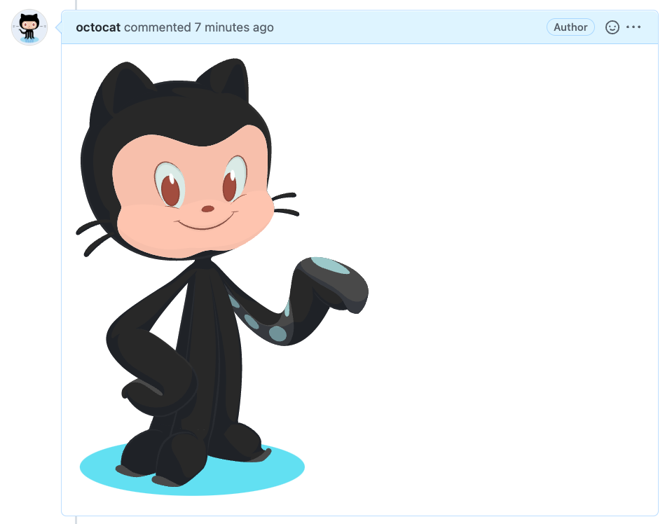

GitHub dá suporte à inserção de imagens em seus problemas, solicitações de pull, discussões, comentários e `.md` arquivos. Você pode exibir uma imagem do repositório, adicionar um link a uma imagem online ou carregar uma imagem. Para obter mais informações, consulte [Carregar ativos](#uploading-assets).

> [!NOTE]
> Quando você quiser exibir uma imagem que esteja em seu repositório, use links relativos em vez de links absolutos.

Aqui estão alguns exemplos para usar links relativos para exibir uma imagem.

| Contexto                                                                      | Link relativo                                                          |
| ----------------------------------------------------------------------------- | ---------------------------------------------------------------------- |
| Em um `.md` arquivo no mesmo branch                                           | `/assets/images/electrocat.png`                                        |
| Em um `.md` arquivo em outro branch                                           | `/../main/assets/images/electrocat.png`                                |
| Em problemas, efetue pull de solicitações e comentários do repositório        | `../blob/main/assets/images/electrocat.png?raw=true`                   |
| Em um `.md` arquivo em outro repositório                                      | `/../../../../github/docs/blob/main/assets/images/electrocat.png`      |
| Em problemas, efetuar pull de solicitações e comentários de outro repositório | `../../../github/docs/blob/main/assets/images/electrocat.png?raw=true` |

> [!NOTE]
> Os dois últimos links relativos na tabela acima funcionarão para imagens em um repositório privado somente se o visualizador tiver pelo menos acesso de leitura ao repositório privado que contém essas imagens.

Para obter mais informações, consulte [Links Relativos](#relative-links).

### O elemento Picture

Há suporte para o `<picture>` elemento HTML.

## Lists

Você pode fazer uma lista não ordenada antes de uma ou mais linhas de texto com <kbd>-</kbd>, <kbd>\*</kbd>ou <kbd>+</kbd>.

```markdown
- George Washington
* John Adams
+ Thomas Jefferson
```

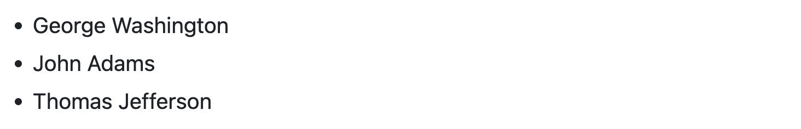

Para ordenar sua lista, preceda cada linha com um número.

```markdown
1. James Madison
2. James Monroe
3. John Quincy Adams
```


### Listas aninhadas

Você pode criar uma lista aninhada recuando um ou mais itens de lista abaixo de outro item.

Para criar uma lista aninhada usando o editor GitHub da Web ou um editor de texto que usa uma fonte monospaceada, como [Visual Studio Code](https://code.visualstudio.com/), você pode alinhar sua lista visualmente. Digite caracteres de espaço na frente do item de lista aninhado até que o caractere de marcador de lista (<kbd>-</kbd> ou <kbd>\*</kbd>) fique diretamente abaixo do primeiro caractere do texto no item acima dele.

```markdown
1. First list item
   - First nested list item
     - Second nested list item
```

> [!NOTE]
> No editor baseado na Web, você pode recuar ou recuar uma ou mais linhas de texto destacando primeiro as linhas desejadas e, em seguida, usando <kbd>Tab</kbd> ou <kbd>Shift</kbd>+<kbd>Tab</kbd> , respectivamente.

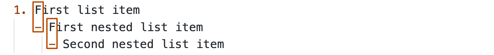


Para criar uma lista aninhada no editor de comentários em GitHub, que não usa uma fonte monospaceada, você pode examinar o item de lista imediatamente acima da lista aninhada e contar o número de caracteres que aparecem antes do conteúdo do item. Em seguida, digite esse número de caracteres de espaço na frente do item de lista aninhado.

Neste exemplo, você pode adicionar um item de lista aninhado no item `100. First list item` de lista recuando o item de lista aninhado no mínimo cinco espaços, já que há cinco caracteres (`100. `) antes `First list item`.

```markdown
100. First list item
     - First nested list item
```

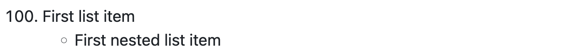

Você pode criar vários níveis de listas aninhadas usando o mesmo método. Por exemplo, como o primeiro item de lista aninhado tem sete caracteres (`␣␣␣␣␣-␣`) antes do conteúdo `First nested list item`da lista aninhada, você precisaria recuar o segundo item de lista aninhado em pelo menos mais dois caracteres (no mínimo nove espaços).

```markdown
100. First list item
     - First nested list item
       - Second nested list item
```

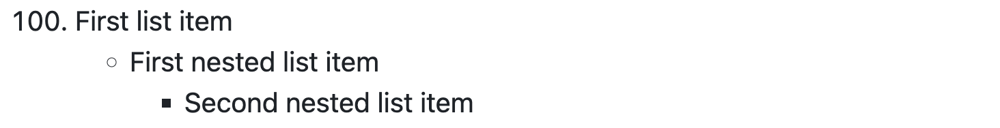

Para obter mais exemplos, consulte o [GitHub Especificação markdown com sabor](https://github.github.com/gfm/#example-265).

## Listas de tarefas

Para criar uma lista de tarefas, coloque um hífen e um espaço seguidos de `[ ]` antes dos itens de lista. Para marcar uma tarefa como concluída, use `[x]`.

```markdown
- [x] #739
- [ ] https://github.com/octo-org/octo-repo/issues/740
- [ ] Add delight to the experience when all tasks are complete :tada:
```

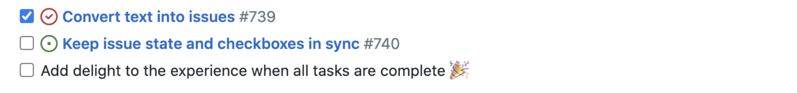

Se uma descrição do item de lista de tarefas começar com um parêntese, você precisará escapar com <kbd>\\</kbd>:

`- [ ] \(Optional) Open a followup issue`

Para saber mais, confira [Sobre as listas de tarefas](/pt/get-started/writing-on-github/working-with-advanced-formatting/about-tasklists).

## Mencionando pessoas e equipes

Você pode mencionar uma pessoa ou [equipe](/pt/organizations/organizing-members-into-teams)GitHub digitando <kbd>@</kbd> mais seu nome de usuário ou nome de equipe. Isso disparará uma notificação e chamará sua atenção para a conversa. As pessoas também receberão uma notificação se você editar um comentário para mencionar seu nome de usuário ou nome de equipe. Para obter mais informações sobre notificações, confira [Sobre notificações](/pt/subscriptions-and-notifications/concepts/about-notifications).

> [!NOTE]
> Uma pessoa só será notificada sobre uma menção se a pessoa tiver acesso de leitura ao repositório e, se o repositório pertencer a uma organização, a pessoa é membro da organização.

`@github/support What do you think about these updates?`


Quando você menciona uma equipe pai, os membros de suas equipes filho também recebem notificações, simplificando a comunicação com vários grupos de pessoas. Para saber mais, confira [Sobre as equipes da organização](/pt/organizations/organizing-members-into-teams/about-teams).

Digitar um <kbd>@</kbd> símbolo abrirá uma lista de pessoas ou equipes em um projeto. A lista filtra conforme você digita, portanto, depois de encontrar o nome da pessoa ou da equipe que você está procurando, você pode usar as teclas de seta para selecioná-la e pressionar uma guia ou inserir para concluir o nome. Para as equipes, insira o @organization/team-name e todos os membros dessa equipe serão inscritos na conversa.

Os resultados do preenchimento automático são restritos a colaboradores do repositório e a qualquer outro participante no thread.

## Referenciando problemas e solicitações de pull

Você pode apresentar uma lista de problemas sugeridos e solicitações de pull dentro do repositório digitando <kbd>#</kbd>. Digite o número ou título do problema ou pull request para filtrar a lista e, em seguida, pressione tab ou enter para concluir o resultado destacado.

Para saber mais, confira [Referências e URLs com links automáticos](/pt/get-started/writing-on-github/working-with-advanced-formatting/autolinked-references-and-urls).

## Referenciando recursos externos

Se as referências de link automático personalizado estão configuradas para um repositório, referências a recursos externos, como um problema do JIRA ou um ticket do Zendesk, serão convertidas em links encurtados. Para saber quais links automáticos estão disponíveis no repositório, entre em contato com alguém com permissões de administrador no repositório. Para saber mais, confira [Configurar links automáticos para fazer referência a recursos externos](/pt/repositories/managing-your-repositorys-settings-and-features/managing-repository-settings/configuring-autolinks-to-reference-external-resources).

## Carregando ativos

Você pode carregar ativos como imagens arrastando e soltando, selecionando em um navegador de arquivos ou colando. Você pode carregar ativos em problemas, solicitações de pull, comentários e `.md` arquivos em seu repositório.

## Usando emojis

Você pode adicionar emoji à sua escrita digitando `:EMOJICODE:`, dois-pontos seguidos pelo nome do emoji.

`@octocat :+1: This PR looks great - it's ready to merge! :shipit:`


Digitação <kbd>:</kbd> abrirá uma lista de emojis sugeridos. A lista será filtrada conforme você digita, portanto, depois de encontrar o emoji que você está procurando, pressione **Tab** ou **Enter** para concluir o resultado realçado.

Para obter uma lista completa de emojis e códigos disponíveis, consulte [o Emoji-Cheat-Sheet](https://github.com/ikatyang/emoji-cheat-sheet/blob/github-actions-auto-update/README.md).

## Parágrafos

Você pode criar um novo parágrafo deixando uma linha em branco entre linhas de texto.

## Notas de rodapé

Você pode adicionar notas de rodapé ao seu conteúdo usando essa sintaxe de colchete:

```text
Here is a simple footnote[^1].

A footnote can also have multiple lines[^2].

[^1]: My reference.
[^2]: To add line breaks within a footnote, add 2 spaces to the end of a line.  
This is a second line.
```

A nota de rodapé será renderizada da seguinte maneira:

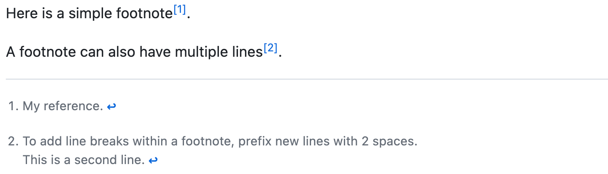

> [!NOTE]
> A posição de uma nota de rodapé em seu Markdown não influencia onde a nota de rodapé será renderizada. Você pode escrever uma nota de rodapé logo após sua referência à nota de rodapé e a nota de rodapé ainda será renderizada na parte inferior do Markdown. Não há suporte para notas de rodapé em wikis.

## Alerts

**Os alertas**, também **conhecidos como textos explicativos** ou **admoestações**, são uma extensão markdown com base na sintaxe de blockquote que você pode usar para enfatizar informações críticas. On GitHub, eles são exibidos com cores e ícones distintos para indicar o significado do conteúdo.

Use alertas somente quando forem cruciais para o êxito do usuário e limitá-los a um ou dois por artigo para evitar sobrecarregar o leitor. Além disso, você deve evitar colocar alertas consecutivamente. Os alertas não podem ser aninhados em outros elementos.

Para adicionar um alerta, use uma linha de blockquote especial especificando o tipo de alerta, seguido pelas informações de alerta em um blockquote padrão. Cinco tipos de alertas estão disponíveis:

```markdown
> [!NOTE]
> Useful information that users should know, even when skimming content.

> [!TIP]
> Helpful advice for doing things better or more easily.

> [!IMPORTANT]
> Key information users need to know to achieve their goal.

> [!WARNING]
> Urgent info that needs immediate user attention to avoid problems.

> [!CAUTION]
> Advises about risks or negative outcomes of certain actions.
```

Aqui estão os alertas renderizados:

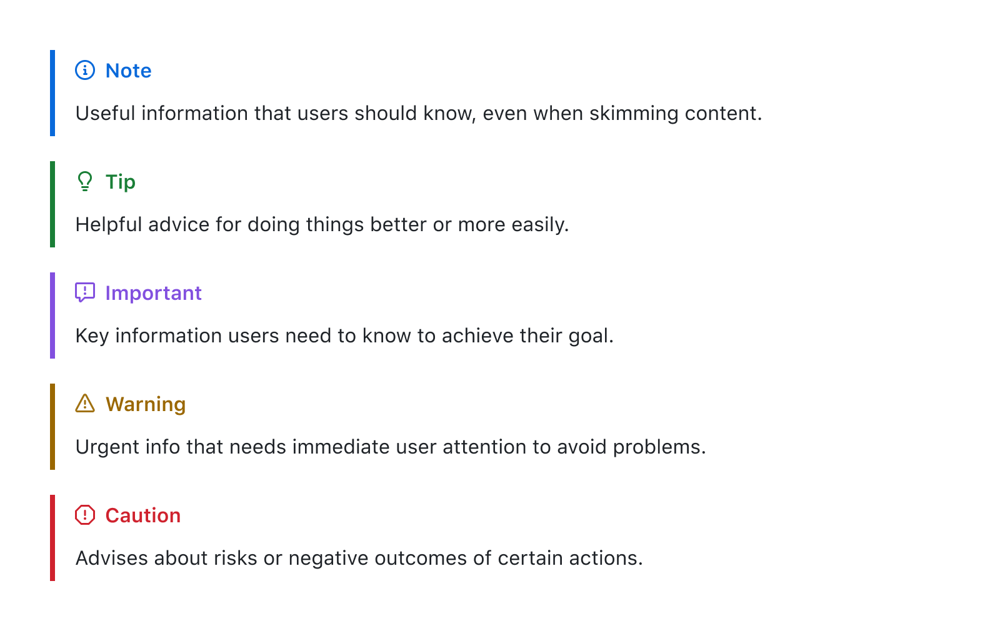

## Ocultar conteúdo com comentários

Você pode dizer GitHub para ocultar o conteúdo do Markdown renderizado colocando o conteúdo em um comentário HTML.

```text
<!-- This content will not appear in the rendered Markdown -->
```

## Ignorando a formatação do Markdown

Você pode dizer GitHub para ignorar (ou escapar) a formatação markdown usando <kbd>\\</kbd> antes do caractere Markdown.

`Let's rename \*our-new-project\* to \*our-old-project\*.`


Para obter mais informações sobre cílios invertidas, consulte A [sintaxe Markdown](https://daringfireball.net/projects/markdown/syntax#backslash) da Bola de Fogo Ousada.

> [!NOTE]
> A formatação markdown não será ignorada no título de um problema ou de uma solicitação de pull.

## Desabilitar a renderização do Markdown

Ao visualizar um arquivo Markdown, você pode clicar em **Code** na parte superior do arquivo para desabilitar a renderização do Markdown e ver a origem do arquivo.

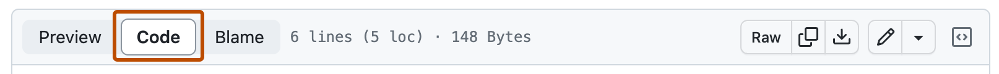

Se você desabilitar a renderização do Markdown, poderá usar recursos de exibição de origem, como vinculação de linha, o que não é possível ao exibir arquivos Markdown renderizados.

## Leitura adicional

* [
  GitHub Especificação de Markdown com sabor](https://github.github.com/gfm/)
* [Sobre como escrever e formatar em GitHub](/pt/get-started/writing-on-github/getting-started-with-writing-and-formatting-on-github/about-writing-and-formatting-on-github)
* [Trabalhar com formatação avançada](/pt/get-started/writing-on-github/working-with-advanced-formatting)
* [Guia de início rápido de gravação no GitHub](/pt/get-started/writing-on-github/getting-started-with-writing-and-formatting-on-github/quickstart-for-writing-on-github)